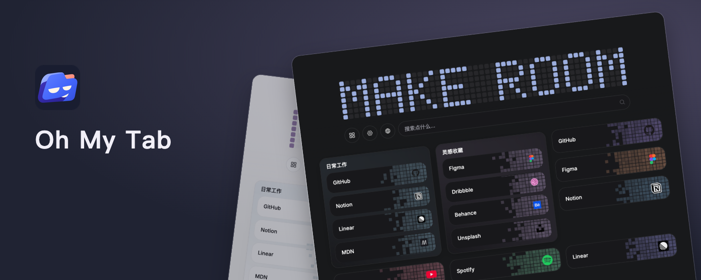

# Oh My Tab

[简体中文](README.md) · **English**

A customizable new tab page for your favorite sites, folders, and widgets.

[Download the latest release](https://github.com/trynewthin/oh-my-tab/releases/latest) · [Website](https://ohmytab.vercel.app/) · [Privacy policy](https://ohmytab.vercel.app/privacy)

- Drag sites and folders to organize them; adjust grid columns and card sizes.
- Find saved bookmarks or search the web with your chosen search engine.
- Make the page your own with clocks, calendars, to-do lists, Pomodoro timers, and other widgets.
- Customize themes, backgrounds, and effects; switch between English and Simplified Chinese.
- Import browser bookmarks and move data with ZIP backups or manual WebDAV sync.

## Install

Install from the [Chrome Web Store](https://chromewebstore.google.com/detail/aihmkimlgdondkkeghfnkiknnocoiioa), or load a release manually:

1. Download the latest ZIP from [Releases](https://github.com/trynewthin/oh-my-tab/releases) and extract it.
2. Open `chrome://extensions/` in Chrome or `edge://extensions/` in Edge.
3. Enable **Developer mode** and select **Load unpacked**.
4. Choose the extracted directory containing `manifest.json`.

Open a new tab to get started. Pin the extension to your toolbar to quickly save the current page. Store updates may arrive later than GitHub releases while they are under review.

## Get started

1. Open **More actions** to add a bookmark or component. To create a folder, right-click empty space on the home page and choose **Add folder**, below **Add component**.
2. Drag cards to arrange your page, or move related bookmarks into a folder.
3. Right-click a card to see its available editing, size, and deletion options.
4. Open **Settings** to change the theme, language, search engine, background, and effects.

## Data and privacy

Bookmarks, layouts, preferences, and background images are stored on your device by default. Oh My Tab contains no advertising or behavioral analytics.

Search suggestions, site icons, bookmark import, WebDAV, and network widgets require you to opt in or initiate the action. ZIP backups are not encrypted; store them securely. See the [privacy policy](https://ohmytab.vercel.app/privacy) for permission usage and network access details.

<details>
<summary>Development and contributions</summary>

Requires Node.js 22.12 or later.

```bash
npm ci
npm run dev
```

See the [project documentation](docs/README.md) for development, testing, and release details (primarily in Chinese).

</details>

## Acknowledgments

Built with React, shadcn/ui, and Tailwind CSS. Drag and drop uses dnd kit, animation uses GSAP, and icons come from Phosphor Icons.
