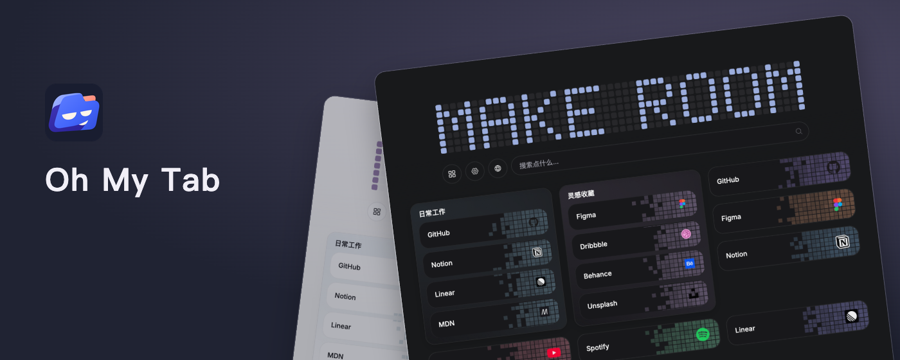

# Oh My Tab

**简体中文** · [English](README.en.md)

把常用网站、文件夹和小组件放进一个可以自由整理的新标签页。

[下载最新版本](https://github.com/trynewthin/oh-my-tab/releases/latest) · [官方网站](https://ohmytab.vercel.app/) · [查看隐私政策](https://ohmytab.vercel.app/privacy)

- 拖动整理网站和文件夹，调整网格列数和卡片大小。
- 搜索已有书签，或使用所选搜索引擎搜索网页。
- 用时钟、日历、待办、番茄钟等小组件丰富主页。
- 自定义主题、背景和动态效果，支持中英文切换。
- 导入浏览器书签，通过 ZIP 备份或手动 WebDAV 同步迁移数据。

## 安装

可以从 [Chrome 应用商店](https://chromewebstore.google.com/detail/aihmkimlgdondkkeghfnkiknnocoiioa) 安装，或手动加载发行版：

1. 从 [Releases](https://github.com/trynewthin/oh-my-tab/releases) 下载最新的 ZIP 文件并解压。
2. 在 Chrome 打开 `chrome://extensions/`，或在 Edge 打开 `edge://extensions/`。
3. 开启「开发者模式」，选择「加载已解压的扩展程序」。
4. 选择包含 `manifest.json` 的解压目录。

安装后打开一个新标签页即可开始使用。将扩展固定到工具栏后，还可以把当前网页快速添加到主页。

## 开始使用

1. 打开「更多操作」添加网站或小组件；新建文件夹请右键点击主界面空白处，在「添加组件」下方选择「添加文件夹」。
2. 拖动卡片调整位置；把相关网站拖进同一个文件夹。
3. 右键点击卡片，编辑内容、调整大小或删除。
4. 点击设置按钮，更换主题、搜索引擎、背景与动态效果。

## 数据和隐私

书签、布局、偏好和背景图片默认保存在当前设备。Oh My Tab 不包含广告或行为分析。

搜索联想、网站图标、书签导入、WebDAV 和联网组件等功能需主动开启或操作。ZIP 备份未加密，请妥善保管。权限用途和联网范围见[隐私政策](https://ohmytab.vercel.app/privacy)。

<details>
<summary>开发与贡献</summary>

需要 Node.js 22.12 或更高版本。

```bash
npm ci
npm run dev
```

开发、测试和发布资料见[项目文档](docs/README.md)。

</details>

## 许可

本项目原创代码采用 [Sustainable Use License 1.0](LICENSE)（`SUL-1.0`）源码可见许可。个人、非商业及企业内部使用免费；对外售卖、收费托管或集成到面向客户的商业产品，需[另行取得商业授权](https://github.com/trynewthin/oh-my-tab/issues)。

第三方组件、字体和图标保留各自的许可证，见 [NOTICE](NOTICE)。具体权利与限制以许可证原文为准。

## 致谢

界面基于 React、shadcn/ui 和 Tailwind CSS，拖拽使用 dnd kit，动画使用 GSAP，图标使用 Phosphor Icons。
