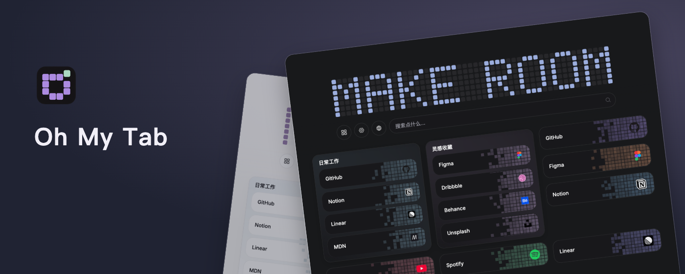

# Oh My Tab

**简体中文** · [English](README.en.md)

把常用网站、文件夹和小组件放进一个可以自由整理的新标签页。

[下载最新版本](https://github.com/trynewthin/oh-my-tab/releases/latest) · [官方网站](https://ohmytab.vercel.app/) · [查看隐私政策](https://ohmytab.vercel.app/privacy)

- 拖动整理网站和文件夹，调整网格列数和卡片大小。
- 搜索已有书签，或使用所选搜索引擎搜索网页。
- 添加时钟、日历、待办、倒数日、番茄钟、下班倒计时、点阵画布和像素花盆。
- 自定义主题、背景和动态效果，支持中英文切换。
- 导入浏览器书签，通过 ZIP 备份或手动 WebDAV 同步迁移数据。

## 安装

可以从 [Chrome 应用商店](https://chromewebstore.google.com/detail/aihmkimlgdondkkeghfnkiknnocoiioa) 安装，或手动加载发行版：

1. 从 [Releases](https://github.com/trynewthin/oh-my-tab/releases) 下载最新的 ZIP 文件并解压。
2. 在 Chrome 打开 `chrome://extensions/`，或在 Edge 打开 `edge://extensions/`。
3. 开启「开发者模式」，选择「加载已解压的扩展程序」。
4. 选择包含 `manifest.json` 的解压目录。

安装后打开一个新标签页即可开始使用。将扩展固定到工具栏后，还可以把当前网页快速添加到主页。

## 开始使用

1. 打开「更多操作」，添加网站、文件夹或小组件。
2. 拖动卡片调整位置；把相关网站拖进同一个文件夹。
3. 右键点击卡片，编辑内容、调整大小或删除。
4. 点击设置按钮，更换主题、搜索引擎、背景与动态效果。

在「更多操作 → 编辑」中，悬停标签或文件夹会显示贴合右下角圆角的拖拽条。拖动时预览已支持的尺寸，松手保存并调整周围布局；按 Esc 取消当前拖拽，再按 Esc 或点击「完成」退出。编辑与批量模式互斥。

在「设置 → 个性化 → 标签」中，条形和方形使用相同的布局、边框、背景、文字与图标分类，各自保存外观、背景样式与覆盖范围，并随备份同步；新标签默认播放开关共用。背景纹理支持以 90° 为步长旋转，以及水平、垂直镜像，不影响遮罩、边框、文字或图标。方形页同时展示 1×1、2×2、4×4 预览，共用同一套方形样式，其中 1×1 仅显示图标；两类预览均按相同缩放比例整体展示，主页的可选标签尺寸不变。

背景覆盖范围为 100% 时，纹理延伸至整个背景，不再保留透明边缘；像素间隙与粒子自身的形状仍保留。

分类栏右侧的「全部重置」需确认后才恢复当前页面的外观默认值。背景分类的重置恢复背景（含旋转和镜像）与遮罩，不修改默认播放设置，也不改变已有标签的播放状态、内容或尺寸。各分类重置按钮位于表单底部右侧：内容较少时贴近页面底部，内容较多时随表单滚动。

在「设置 → 个性化 → 文件夹」中可调整圆角、边框类型、粗细、颜色和不透明度；不改变文件夹大小，也不影响内部标签样式。底部「重置样式」经确认后恢复文件夹纹理、圆角和边框。

## 数据和隐私

书签、布局、偏好和背景图片默认保存在当前设备。Oh My Tab 不包含广告或行为分析。

搜索联想、第三方网站图标、浏览器书签导入、WebDAV，以及天气和 RSS 组件的联网读取都需要你主动开启或操作。天气不调用设备定位，联网组件不会在添加或预览时自动请求。ZIP 备份未加密，请像保管普通备份文件一样妥善保存。权限用途和联网范围见[隐私政策](https://ohmytab.vercel.app/privacy)。

<details>
<summary>开发与贡献</summary>

需要 Node.js 22.12 或更高版本。

```bash
npm ci
npm run dev
```

开发、测试和发布资料见[项目文档](docs/README.md)。

</details>

## 致谢

界面基于 React、shadcn/ui 和 Tailwind CSS，拖拽使用 dnd kit，动画使用 GSAP，图标使用 Phosphor Icons。
