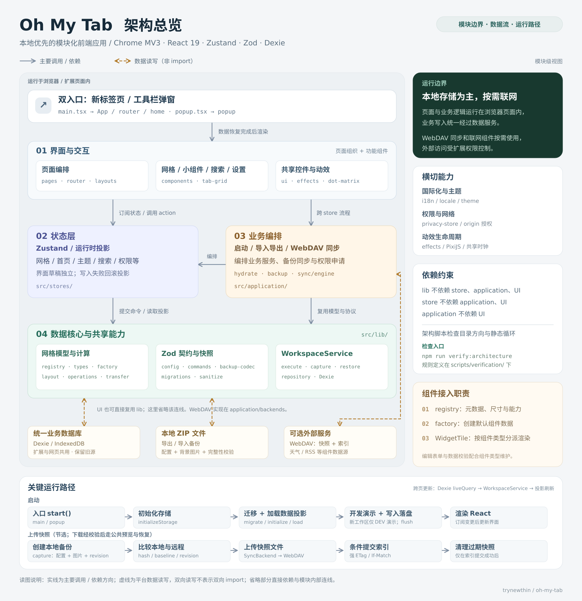

# 开发架构

[返回文档中心](../README.md)

## 架构总览

## 模块边界

- `src/main.tsx` / `src/popup.tsx`：新标签页与工具栏入口；`src/pages/` 组合页面。
- `src/components/`：界面与交互。通用控件在 `ui/`，网格与拖拽在 `tab-grid/`，视觉效果在 `effects/`。
- `src/stores/`：运行时状态、业务数据投影与 action；`src/application/`：启动、备份、同步等应用流程。
- `src/lib/`：模型、计算和浏览器适配器，不依赖 store 或界面。

业务写入经公共数据服务完成；视图不另建数据转换流程。文件夹与待办复用 `tab-grid/collection/`，其他共用表面放 `shared/`。导入方向、数据核心的框架依赖和静态循环由 `npm run verify:architecture` 检查，规则以该脚本为准。

设置表单复用 `settings/shared/` 的设置行、控件表面样式与数值滑块；需要数值输入时由同一个滑块组件提供，不在页面内另建组合控件。分类底部重置保留独立的确认交互。

## 网格

组件元数据与尺寸以 `src/lib/grid/registry.ts` 为准，新增组件见[组件开发](widgets.md)。

`grid-layout.ts` 计算布局，`grid-operations.ts` 处理成组，`tab-transfer.ts` 处理主页与文件夹间移动；拖拽层只编排这些操作。删除撤销只恢复本次删除的内容，不覆盖之后的修改。

## 数据服务与运行时状态

业务数据以数据库为权威来源，Zustand 保存页面投影、编辑草稿和交互状态。业务 action 通过投影控制器提交命令；直接 `setState` 不会持久化业务数据。写入失败回滚投影并反馈错误，后台刷新不能覆盖尚未提交的编辑。

`src/lib/data/` 的 Zod 契约与 `WorkspaceService` 不依赖 React、Zustand、Chrome API 或文案。应用通过 `application/workspace.ts` 访问服务；替换实现的端口在 `data/service-client.ts`，应在初始化前配置。当前提供 Dexie 本地实现，HTTP 服务可实现同一端口。

命令使用预期 revision 防止静默覆盖，使用 requestId 支持有期限的幂等重试。配置、资源引用、文档版本与回执在同一事务提交；图片解码、哈希、压缩和网络操作在事务外完成。通知只触发重新读取，页面重新激活时也会刷新权威数据。

## 存储与迁移

扩展和网页的本地实现统一使用 Dexie / IndexedDB。`src/lib/storage.ts` 保留底层与旧调用的兼容入口，不承载新的业务规则。完成迁移和投影加载后才渲染主界面。

- 版本由 `src/lib/data-version.ts` 定义。历史转换放 `src/lib/migrations/`，先转换、校验、保存，再加载 store；不能依赖用户下次编辑才写回新格式。
- 首次切换从扩展的 Chrome Storage 或网页旧 IndexedDB 复制数据，在新库完成事务后记录检查点，保留旧源和救援数据；旧扩展再次修改业务数据时阻止静默混写。当前存储优先于更早的 localStorage，包括删除标记；提交成功后才清理 localStorage 副本。
- 完成标记不能代替逐项版本检查。已写入的数据版本不得因源码回退而重用；未知未来格式拒绝覆盖。
- 导入不修改用户选择的备份文件。备份结构与完整性检查在 `backup-codec.ts`，本地备份和 WebDAV 共用服务的快照、恢复预览与条件提交。资源清理同时保护当前背景和救援副本的引用。
- WebDAV 快照先上传，再以强 ETag 条件提交索引，最后清理旧文件。索引提交失败时仍须保留可用的源文件。

持久化格式变化需一起处理校验、迁移、导入导出和回归测试；移除历史转换前先确定最低支持版本。

## 动效

共享时钟、显隐生命周期和测量在 `src/components/effects/`。业务组件不另建逐帧时钟；离屏或页面隐藏时暂停，卸载时释放图形资源，尊重系统减少动态效果设置。

标签样式与纹理几何独立：纹理使用固定尺寸的正方形像素，顶部从完整一行开始，向下铺满容器；末行超出底边的部分裁切，不额外留白，也不拉伸像素。文件夹跨行连续性通过纹理行序号表达，不能用局部高度反算像素步长或裁切首行；边框限定纹理区域，圆角负责轮廓裁切。DOM 与 Canvas 渲染器遵循同一几何规则。

标签背景保留原有不透明的主题卡片底色（`--card`），在其上绘制背景纹理，最后绘制遮罩。新配置和重置后的遮罩默认透明且不模糊；遮罩透明不代表标签底色透明，已保存的遮罩选择保留。遮罩的不透明度与模糊只作用于遮罩，不改变背景自身透明度或像素几何；不透明遮罩覆盖背景是正常合成结果。设置页将背景与遮罩放在同一表单中，现有持久化字段保持兼容。
